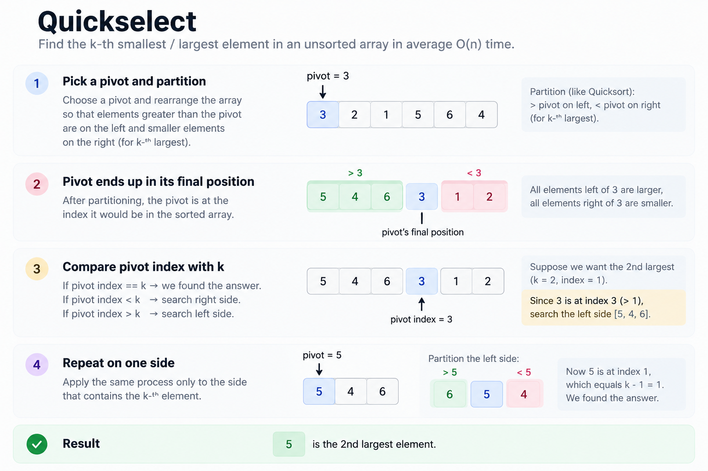

# Quickselect

One of the classics to find the kth order element



```python
from random import randint

class Solution:
    def findKthLargest(self, nums: list[int], k: int) -> int:
        # kth largest = (n - k)th index in ascending sorted order
        target = len(nums) - k

        def quickselect(left, right):
            # Pick a random pivot to avoid consistently bad partitions
            p = randint(left, right)
            # swap so that the last element is the pivot
            nums[p], nums[right] = nums[right], nums[p]
            pivot = nums[right]

            # Partition: elements <= pivot go to the left
            i = left  # Next position for an element <= pivot

            for j in range(left, right):
                if nums[j] <= pivot:
                    nums[i], nums[j] = nums[j], nums[i]
                    i += 1

            # Place pivot at its final sorted position
            nums[i], nums[right] = nums[right], nums[i]

            # Pivot is exactly at the kth largest element's index
            if i == target:
                return nums[i]

            # Target lies to the right of the pivot
            if i < target:
                return quickselect(i + 1, right)

            # Target lies to the left of the pivot
            return quickselect(left, i - 1)

        # Search the entire array initially
        return quickselect(0, len(nums) - 1)
```
