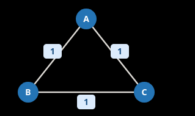

# Critical and pseudo-critical edges in MST

For an MST, if an edge del will increase wt of ALL MSTs it's critical.
If an edge del will not increase wt for SOME MST, it's pseudo-critical.
Finl all.

## Solution

Think of how an MST is made. You greedily pick the smallest edges that JOIN two
disjoing components.
If I take the set of all edges with wt w and keep a counter of (a,b) the components
they join ( the components must be disjoint ), then if counter is 1 it's critical else
it's pseudocritical.

**counterexample**


If you do a counter, all 3 become critical, but all 3 are pseudocritical.

## Way 1 - repeated kruskal

Find the optimal wt.
For each edge e, remove, find the new wt, if we cannot connect all or wt is more it's
critical.
If it's not critical, use THAT e first ( among all the same wt ones ) and if wt is
still same it's pseudocritical.
What if for the same wt level, componets are already connected? No need to go to the
end, it's not critical or pseudocritical.

```python
class Solution:
    def findCriticalAndPseudoCriticalEdges(
        self, n: int, edges: list[list[int]]
    ) -> list[list[int]]:
        # DSU
        par = [-1] * n

        def root(a):
            if par[a] < 0:
                return a
            # something like return par[a] = root(par[a]) is not valid
            # in python
            par[a] = root(par[a])
            return par[a]

        def merge(a, b):
            # the one line assign and compare is also not valid
            a, b = root(a), root(b)

            if a == b:
                return False

            # assume a is the larger one for merging small to large
            if -par[a] < -par[b]:
                a, b = b, a

            par[a] += par[b]
            par[b] = a
            return True

        def reset():
            nonlocal par
            par = [-1] * n

        # (weight, u, v, original_index)
        edges = sorted((wt, a, b, i) for i, (a, b, wt) in enumerate(edges))

        def mst(remove=None, first=None):
            reset()
            total = 0
            used = 0
            first_done = False

            fw = None if first == None else edges[first][0]

            for idx, (wt, a, b, _) in enumerate(edges):

                # Force 'first' before any other edge
                # of its weight, but after all smaller edges.
                if fw == wt and not first_done:
                    fw, fa, fb, _ = edges[first]

                    if not merge(fa, fb):
                        return float("inf")

                    total += fw
                    used += 1
                    first_done = True

                if idx == remove or idx == first:
                    continue

                if merge(a, b):
                    total += wt
                    used += 1

            if used == n - 1:
                return total

            # disconnected
            return float("inf")

        optimal = mst()

        critical = []
        pseudo = []

        for idx, (wt, a, b, original_idx) in enumerate(edges):

            # What if we remove this edge?
            if mst(remove=idx) > optimal:
                critical.append(original_idx)

            # What if we force this edge?
            elif mst(first=idx) == optimal:
                pseudo.append(original_idx)

        return [critical, pseudo]
```

## Way 2 - Bridge finding

For any same wt edge group. If comps are connected already, you skip those.
Otherwise the remaining same wt edges as the edge set and the components as nodes,
you make a temp graph. Edges that are a "bridge" in this graph are critical while
rest are pseudocritical.

TODO: impl
