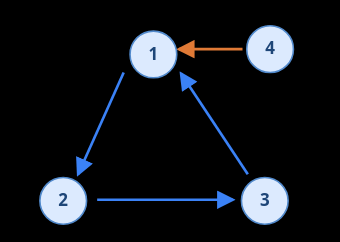
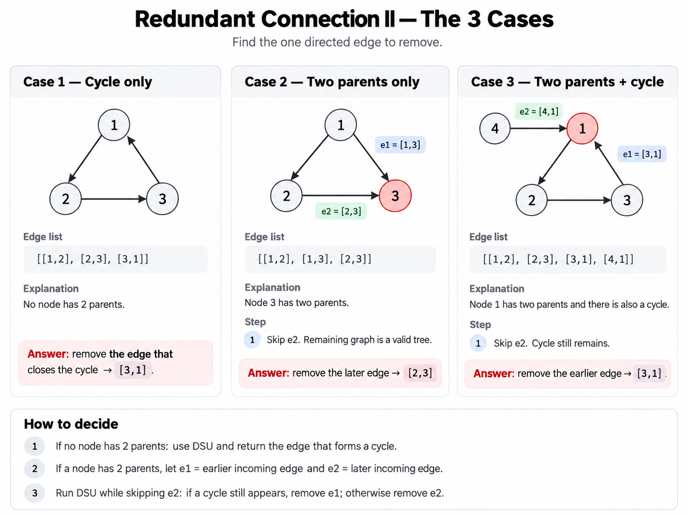

# Redundant Connections II

On a tree, one extra edge is added. Find it.

## Solution

Given the contraints, an obvious solution is loop over every edge, remove it and see
if the remaining is still a tree. But can we do better?

If an additional edge is added, then there are two cases; note that it is directed

- so if you follow the tree egde direction and NOT make a loop, some node will have
  two parents
- or if you change the direction, there will be a loop.

Both can happen simultaneously as well.


Here is the idea for an O(n) solution


Why does earlier vs later matter? It doesn't that is just the order the edges are
given in input and the problem stating that return the "later" one.

Note that in case two, there are two possible removals. In case one, cycle len number
of possible removals and in the last case ONLY one.

---

Let's try to simplify getting to the solution.

> A rooted directed tree has exactly one parent for every node except the root.

So if none of them have a double parent just find a cycle.
Pick the parent edges and see removing which of those gives you a tree. You can do that
in two iterations but you can also do this.

```python
e1, e2 = find_two_parent_edges() # just return None here

for edge in edges:
    if edge == e2:
        continue

    if not merge(u, v):
        # wait but if e2 was the bad one we shouldn't be here
        if e1 exists:
            # it's not the no double parent exists case
            return e1
        # it's the no double parent case
        return edge

return e2
```

```python
class Solution:
    def findRedundantDirectedConnection(self, edges: List[List[int]]) -> List[int]:
        n = len(edges)

        def find_two_parent_edges():
            incoming = {}

            for i, (u, v) in enumerate(edges):
                if v in incoming:
                    return incoming[v], i  # earlier, later
                incoming[v] = i

            return -1, -1

        # DSU
        par = [-1] * (n + 1)

        def root(a):
            if par[a] < 0:
                return a
            par[a] = root(par[a])
            return par[a]

        def merge(a, b):
            a, b = root(a), root(b)

            if a == b:
                return False

            if -par[a] < -par[b]:
                a, b = b, a

            par[a] += par[b]
            par[b] = a
            return True

        # Find the two edges pointing to the same node
        e1, e2 = find_two_parent_edges()

        # Try removing the later edge (e2)
        for i, (u, v) in enumerate(edges):
            if i == e2:
                continue

            if not merge(u, v):
                if e1 != -1:
                    return edges[e1]
                return edges[i]

        return edges[e2]
```
