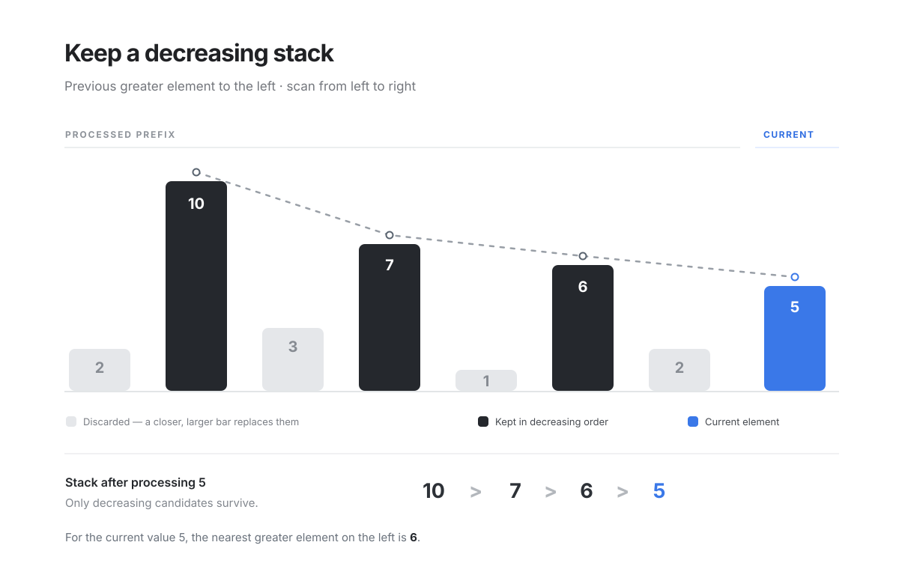

# Monotonic Stack

## When To Use

**nearest greater/smaller element** on any side is the usual application.

## Template

_Here's a line of reasoning_.

I want the next greater element to the left so I have to have processed the left prefix ( this gives me the scan order ) and since I want larger to my current one, all I should care about is the largest to the left, then the second largest which might be nearer and so on ( look at the image below ).



## Two ways to implement

### Candidate List ( preferred )

The current element is looking backward for an answer

```python
for i in scan order:
    # stack is my set of candidates
    while stack not empty and should_pop(nums[stack.top], nums[i]):
        stack.pop()

    # the top candidate if it exsits exists is my answer
    if stack:
        ans[i] = stack.top()

    stack.push(i)
```

Try to remember the image above, if you want larger ones, naturally you want to keep the largest and then second largest, which gets you to a decreasing stack.

An inceasing one naturally gives you the smaller elements.

### Waiting Room

_this is like the dual of the above, you handle the reverse side of inequality here_

The previous elements are waiting for the current element to become their answer.

```python
for i in scan order:
    while stack not empty and current answers for stack.top:
        ans[stack.top] = i
        pop

    push i
```

## Problems

_**Trivial impl**_

_try to do both approaches for this_

- [Next greater element](https://leetcode.com/problems/next-greater-element-i/description/)

_**Monotonic stack**_

- [Next Greater Element II aka cyclic greater](https://leetcode.com/problems/next-greater-element-ii/)
  - Idea is to use virtual indexing to double the array and then scan
- [Number of Visible People in a Queue](https://leetcode.com/problems/number-of-visible-people-in-a-queue/description/)
- [132 pattern](https://leetcode.com/problems/132-pattern/description/)

_**When waiting room becomes more intuitive**_

- https://leetcode.com/problems/next-greater-node-in-linked-list/description/
- https://leetcode.com/problems/daily-temperatures/description/

---

# Some generalised variations

## Boundaries

### Template

```python
for i:
    left = previous_boundary
    right = next_boundary

    # do something with the element and the boundary
    res = f(nums[i], left, right)
```

**Duplicates need asymmetric comparisons!**
Include equals on one side and exclude equals on the other.

### Problems

**Contribution of min/max**

> When summing over **all subarrays** and each element contributes as the **minimum or maximum** over some range/

- [Sum of subarray minimums](https://leetcode.com/problems/sum-of-subarray-minimums/description/)
  - $\sum_{subarray} min$
- [Subarray ranges](https://leetcode.com/problems/sum-of-subarray-ranges/description/)
  - $\sum_{subarray} max - min$

- [Min + Max of sums of at most k subarrays](https://leetcode.com/problems/maximum-and-minimum-sums-of-at-most-size-k-subarrays/description/)
  - this is trickier as it uses the asymmetric comparison idea
  - $\sum_{|S| \le k} min + max$

- [Total srengh of wizards](https://leetcode.com/problems/sum-of-total-strength-of-wizards/description/)
  - $\sum_{subarray} min(subarray) * sum(subarray)$

**Widest valid range**

> Use the current element and the widest range including it

- [Largest rectangle in histogram](https://leetcode.com/problems/largest-rectangle-in-histogram/description/)
  - each bar is the limiting height for its widest range
- [Maximal rectangle](https://leetcode.com/problems/maximal-rectangle/description/)
  - turn each row into histogram heights and find the largest rectangle
- [Maximum subarray min-product](https://leetcode.com/problems/maximum-subarray-min-product/description/)
  - use the widest range where each value is the minimum, with prefix sums
- [Valid subarray size](https://leetcode.com/problems/subarray-with-elements-greater-than-varying-threshold/description/)
  - find a range where $min(subarray) \times len > threshold$
- [Count all-1 submatrices](https://leetcode.com/problems/count-submatrices-with-all-ones/description/)
  - use histogram heights and previous-smaller compression to count rectangles

---

## Greedy Remove Stack

Useful when building a lexicographically smallest/largest subsequence while you are allowed to drop elements.

The core idea is a "greedy exchange" argument, I maintain a candidate list and if my stack has a worse off element, I replace.

### Template

```python
for x in sequence:
    while stack and can_drop(stack.top):
        pop

    push(x)

trim if needed # some problems need this, easy to miss
```

### Problems

- [Remove duplicate letters](https://leetcode.com/problems/remove-duplicate-letters/description/)
  - pop larger characters only if they appear again later
- [Remove k digits](https://leetcode.com/problems/remove-k-digits/description/)
  - pop larger previous digits while removals remain
- [Most competitive subsequence](https://leetcode.com/problems/find-the-most-competitive-subsequence/description/)
  - pop larger previous elements while enough elements remain
- [Create maximum number](https://leetcode.com/problems/create-maximum-number/description/)
  - build the best subsequence from each array, then merge them lexicographically
- [Smallest subsequence with required letter repetition](https://leetcode.com/problems/smallest-k-length-subsequence-with-occurrences-of-a-letter/description/)
  - track the remaining length and required letter count when removing characters

---

## Farthest Candidate Stack

_a spinoff!_ where you want the farthest greater or smaller

### if I need it for all indexes

Then sorting is easiest. Say I want the farthest smaller element to the right. Then I can sort ascending and start processing from largest first.

```python
order = sorted(range(n))
ans = [-1] * n
max_idx = -1

for group in equal_value_groups(order):
    # as I iterate in increasing element, keep track of the MAX I've seen to the max that was processed earlier ( and hence smaller )
    for i in group:
        if max_idx > i:
            ans[i] = max_idx

    for i in group:
        max_idx = max(max_idx, i)
```

### [Max width ramp](https://leetcode.com/problems/maximum-width-ramp/description/)

> This the whole reason for this page, there is an $O(n)$ solution if you care only about the largest gap

Maximize distance such that $i < j$ and $nums[i] <= nums[j]$.

Note two things

- for every $j$, if I can find the best $i$, I have my solution
- If an $i$ is discarded, then it's farthest $j$ must have been processed, hence the reverse

```python
n = len(nums)
cand = []

# builds a decreasing stack in index order
for i in range(n):
    if not stack or nums[i] < nums[stack[-1]]:
        stack.append(i)

ans = 0

# Try right endpoints (j), right to left
for j in range(n - 1, -1, -1):
    while stack and nums[stack[-1]] <= nums[j]:
        i = stack.pop()
        ans = max(ans, j - i)
        # I can discard because no smaller j paired with this i can be better

return ans
```

### Problems

- [Max width ramp](https://leetcode.com/problems/maximum-width-ramp/description/)
- [Longest well performing interval](https://leetcode.com/problems/longest-well-performing-interval/description/)
